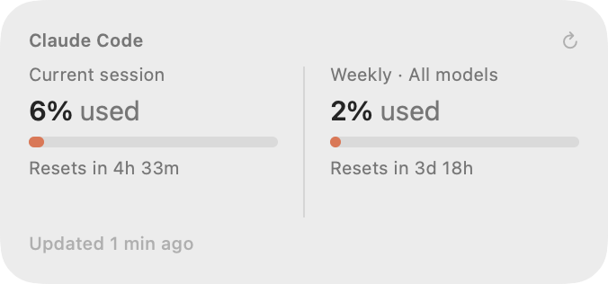
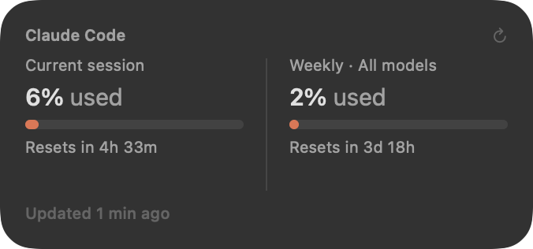
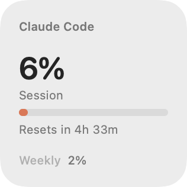
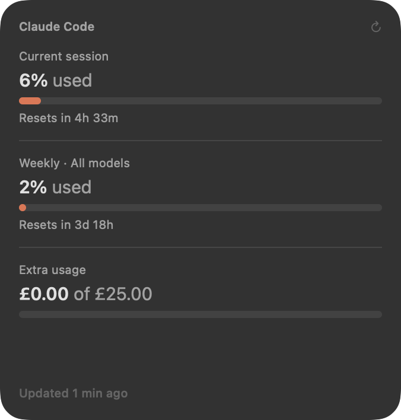
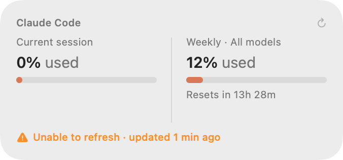
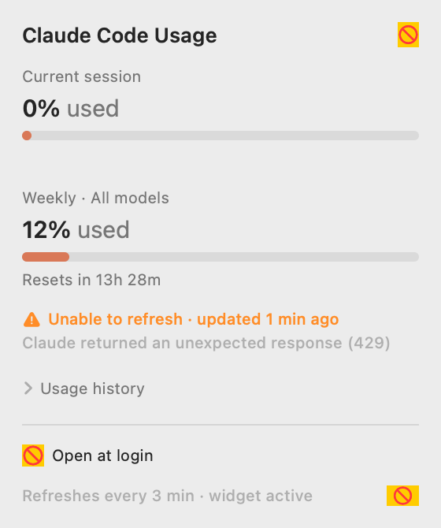
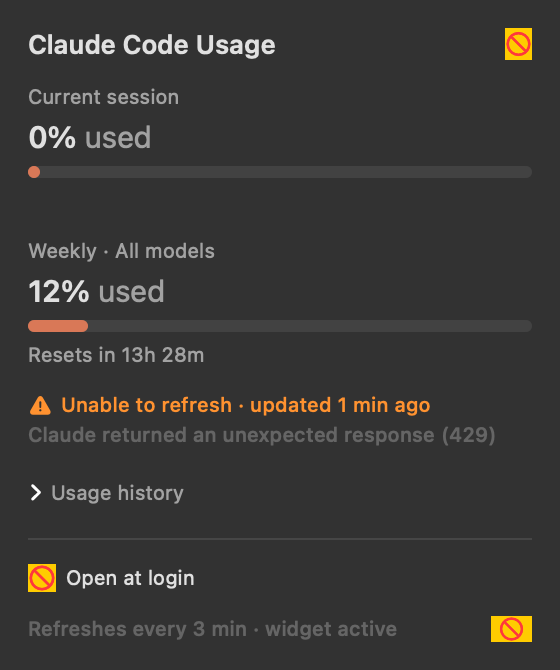

# ClaudeMeter

A native macOS widget and menu bar app that shows your **Claude Code subscription
usage** at a glance — current session, weekly limit, and live reset countdowns —
without opening Claude Code or a browser.



It reads the same numbers as the `/usage` screen in Claude Code, from the same
endpoint, using the sign-in Claude Code already stores. There is nothing to paste
and nothing to configure.

---

## Contents

- [What you get](#what-you-get)
- [Screenshots](#screenshots)
- [Requirements](#requirements)
- [Install](#install)
- [How authentication works](#how-authentication-works)
- [Behaviour and reliability](#behaviour-and-reliability)
- [How it is put together](#how-it-is-put-together)
- [Building a widget without Xcode: what macOS actually requires](#building-a-widget-without-xcode-what-macos-actually-requires)
- [Troubleshooting](#troubleshooting)
- [The shadow toolchain](#the-shadow-toolchain)
- [Limitations](#limitations)

---

## What you get

**A WidgetKit widget** in three sizes for the desktop and Notification Center:

| Size | Shows |
|---|---|
| Small | Session percentage, bar, reset countdown, weekly percentage |
| Medium *(primary)* | Session and weekly side by side, both bars and countdowns |
| Large | Session, weekly, and extra-usage credits, with separators |

**A menu bar companion** showing your session percentage next to a gauge icon.
Click it for the full panel: manual refresh, per-day usage history,
open-at-login, and troubleshooting status.

Both adapt to Light and Dark Mode, use the macOS system font, and lean on Claude's
coral as the single accent colour — the bar shifts to amber above 75% and red
above 90%, so a glance tells you where you stand.

## Screenshots

**Medium — light and dark**

 

**Small and large**

 

**Error state** — the last good reading stays on screen, clearly marked. It never
invents a number or falls back to a misleading 0%.



**Companion panel**

 

## Requirements

- macOS 15 or later (built and tested on macOS 26)
- Apple Silicon (the build script targets `arm64`; change `TARGET` in `build.sh` for Intel)
- Xcode **not** required — Command Line Tools are enough (`xcode-select --install`)
- Claude Code installed and signed in

## Install

```bash
git clone https://github.com/mandalswarnim/claude-meter.git
cd claude-meter
./build.sh
cp -R "build/ClaudeMeter.app" /Applications/
open /Applications/ClaudeMeter.app
```

Then add the widget: **right-click the desktop → Edit Widgets… → search
"Claude" → ClaudeMeter**, and pick a size (medium recommended). If it isn't in
the gallery yet, run `killall chronod` — the widget host rescans when it
relaunches — and reopen the gallery.

In the menu bar panel, tick **Open at login** so usage keeps refreshing on its own.

> If your menu bar is managed by Ice, Bartender, or similar, new icons are hidden
> by default. Expand the hidden section and drag the ClaudeMeter icon into the
> visible area.

## How authentication works

Claude Code stores an OAuth token in your login Keychain under the item
**"Claude Code-credentials"**. ClaudeMeter reads that same token through
`/usr/bin/security`, which is already on that item's access list, so no password
prompt appears and you are never asked to paste a credential. It then calls:

```
GET https://api.anthropic.com/api/oauth/usage
Authorization: Bearer <token>
anthropic-beta: oauth-2025-04-20
```

the endpoint behind Claude Code's own `/usage` screen.

This is strictly read-only. The app never writes, refreshes, or rotates your
credentials — Claude Code owns them — and the token is sent nowhere except
`api.anthropic.com`. The widget, which runs sandboxed, reads the credentials file
through a narrow read-only exception and holds no copy of its own.

When the token expires, the widget and panel say **"Sign in via Claude Code"**.
Run `claude` in a terminal — it refreshes its own credentials — then hit refresh.

## Behaviour and reliability

- The app refreshes every 5 minutes, plus on wake, on panel open, and whenever
  the widget is tapped (`claudeusage://refresh`). Each result is written to
  `~/Library/Application Support/ClaudeCodeUsage/state.json` and the widget
  timelines are reloaded.
- The widget renders that shared snapshot. If it is more than 10 minutes old, or a
  reset boundary has passed, the widget fetches on its own — so it stays current
  even when the app isn't running, within WidgetKit's refresh budget.
- **Countdowns tick without network traffic.** Each timeline carries 90
  per-minute entries, so "Resets in 3h 39m" becomes "3h 38m" on its own.
- **Failure never fabricates data.** These states are distinguished and shown
  honestly: loading, authentication required, rate limited, network failure,
  service error, and no-data-yet. On failure the last good snapshot stays
  visible, labelled *"Unable to refresh · updated 12 min ago"* — never a fake
  `0%`, `100%`, or blank.
- **Rate limiting is handled as pacing, not failure.** The usage endpoint
  returns HTTP 429 if it is polled too hard, and the app and widget share one
  budget. When that happens the app honours `Retry-After` (clamped to 30s–15m),
  refuses to send anything until the cooldown lapses, then retries on its own —
  the widget schedules its next timeline for the same moment. The footer reads
  *"Retrying in 2m · updated 3 min ago"* in a neutral colour rather than an
  alarming "Unable to refresh".
- **Expired tokens are never spent.** Claude Code leaves a stale copy of its
  credentials on disk; a token past expiry is ignored rather than sent, since a
  doomed request only draws down the rate limit. The widget, which is sandboxed
  and cannot read the Keychain, therefore renders the app's snapshot instead of
  failing on its own.
- Reset countdowns come from the `resets_at` timestamps in the response. Nothing
  about the schedule is hardcoded.
- The panel footer reports whether the widget extension has actually rendered
  recently (`widget active` / `widget not added yet`), which makes "is it
  working?" answerable without guesswork.

## How it is put together

```
Shared/     Model, store, credential reader, fetcher, and the widget faces
            (compiled into both targets — one source of truth for the design)
App/        Menu bar app, panel UI, preview renderer
Widget/     WidgetKit bundle and timeline provider
Support/    Info.plists, entitlements, icon generator
build.sh    Compiles, assembles, and ad-hoc signs the app + appex
docs/       Screenshots, generated by the preview renderer
```

The app and the widget share `Shared/UsageViews.swift`, so what you see in the
gallery, on the desktop, and in the panel is literally the same SwiftUI code.

`App/PreviewRenderer.swift` renders every size in both colour schemes to PNGs
without needing to place a widget by hand — how the screenshots above were made:

```bash
CCU_RENDER_PREVIEWS=/some/dir "build/ClaudeMeter.app/Contents/MacOS/ClaudeUsage"
```

## Building a widget without Xcode: what macOS actually requires

Xcode normally hides all of this. Every item below fails **silently** — the
widget simply never appears in the gallery, with no error surfaced anywhere in
the UI. Written down in case it saves someone else the afternoon.

1. **The entry point must be `NSExtensionMain`.** App extensions do not start at
   the usual Swift `main`. Link with `-Xlinker -e -Xlinker _NSExtensionMain`;
   WidgetKit's XPC host bootstraps there and finds the `@main WidgetBundle`
   through its protocol conformance. Without it the process launches and dies
   instantly with `Fatal error: Unrecognized extension type`, which reaches
   chronod only as `RBSRequestErrorDomain Code=5 "Launch failed."` followed by
   `Unknown extension process`.

   Two ways to check: `nm -u <appex binary> | grep NSExtensionMain` should find
   the symbol, and running the binary directly should answer
   *"An XPC Service cannot be run directly."* — the same response you get from
   Apple's and Microsoft's shipping widgets.

2. **Layout must be `Contents/PlugIns/<name>.appex`** with package type `XPC!`
   and an `NSExtension` dictionary declaring
   `NSExtensionPointIdentifier = com.apple.widgetkit-extension`. The ExtensionKit
   style (`Contents/Extensions` plus `EXAppExtensionAttributes`) is for other
   extension points; used here, chronod logs
   `Ignoring restricted or unknown extension`.

3. **The extension must be sandboxed.** `pkd` refuses to register an unsandboxed
   app extension, so it never reaches the widget gallery at all. Add
   `com.apple.security.app-sandbox` (plus `network.client` if it fetches).

4. **Sharing state with a sandboxed extension needs thought.** App groups are the
   textbook answer, but they need a real Team ID —
   `~/Library/Group Containers` is managed by `containermanagerd`, which will not
   create a group you cannot prove you own, and
   `containerURL(forSecurityApplicationGroupIdentifier:)` cheerfully reports
   success while handing back an unwritable path. This project uses a sandbox
   temporary exception for its Application Support folder instead.

5. **`CFBundleSupportedPlatforms` = `[MacOSX]`** on the appex, matching shipping
   widgets.

### Debugging commands

```bash
# Is the extension registered with the system?
pluginkit -m -v -i <widget bundle id>

# What did the widget host decide? (the only place the real error appears)
/usr/bin/log show --last 5m --info --debug \
  --predicate 'subsystem == "com.apple.chrono"' | grep -i <your id>

# Force a rescan and a descriptor re-fetch
killall chronod
```

Two traps worth knowing:

- **Use the full path `/usr/bin/log`.** zsh has a builtin named `log` that
  shadows it; a bare `log show ...` fails with `too many arguments`, which is
  easy to read as "the system logged nothing".
- **chronod caches descriptors.** Once fetched, it will not relaunch your
  extension on rebuild. Bump the appex's `CFBundleVersion` to force a re-fetch.

The widget writes lifecycle breadcrumbs to
`~/Library/Application Support/ClaudeCodeUsage/widget-trace.log`
(`bundle.init` → `bundle.body` → `widget.body` → `provider.*`). Since macOS
launches the extension on its own schedule, in its own sandbox, this is the only
practical window into whether it ran and how far it got. A healthy scan looks like:

```
bundle.init
bundle.body
widget.body
provider.placeholder      ← once per supported family
provider.placeholder
provider.placeholder
```

## Troubleshooting

**The widget isn't in the gallery.** Confirm registration with
`pluginkit -m -v -i com.swarnim.ClaudeCodeUsage.Widget`. If it is listed, run
`killall chronod` and reopen the gallery. If it is not, the app is probably
outside `/Applications`; re-register with
`lsregister -f /Applications/ClaudeMeter.app` (the tool lives under
`/System/Library/Frameworks/CoreServices.framework/Frameworks/LaunchServices.framework/Support/`).

**No menu bar icon.** A menu bar manager such as Ice or Bartender is hiding it.
Expand the hidden section and drag it out.

**"Sign in via Claude Code."** The stored token expired. Run `claude`, then refresh.

**The widget shows an old timestamp.** That is by design — it is telling you the
truth about when the data was last confirmed. Tap it to force a refresh; if the
app is not running, launch it.

## The shadow toolchain

`build.sh` may create a `.toolchain-shim/` directory. This works around a broken
Command Line Tools install where `usr/include/swift/` contains **both**
`module.modulemap` and `bridging.modulemap`, each defining `module SwiftBridging`.
That duplication fails every clang module build with
`redefinition of module 'SwiftBridging'`, accompanied by misleading
"this SDK is not supported by the compiler" errors.

The shim is a shadow toolchain: compiler binaries copied, everything else
symlinked, the duplicate modulemap left out. The script detects the condition and
skips the shim entirely on a healthy install. If your CLT is fine, you will never
see the directory. (The underlying fix, if you want it:
`sudo rm /Library/Developer/CommandLineTools/usr/include/swift/module.modulemap`.)

## Limitations

- **The usage endpoint is not a documented public API.** It is what Claude Code
  itself calls, and Anthropic may change it. If the response shape changes, the
  app reports a service error rather than showing a wrong number.
- **Ad-hoc signed.** Fine for a local build; copying the built app to another Mac
  will trip Gatekeeper. Build it there instead.
- Usage history is collected only while the app runs, and keeps the last 14 days.
- Single account — whichever one Claude Code is signed into.

## Licence

MIT
